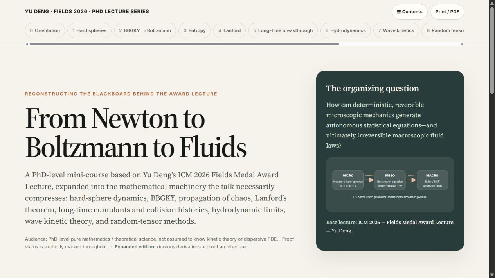
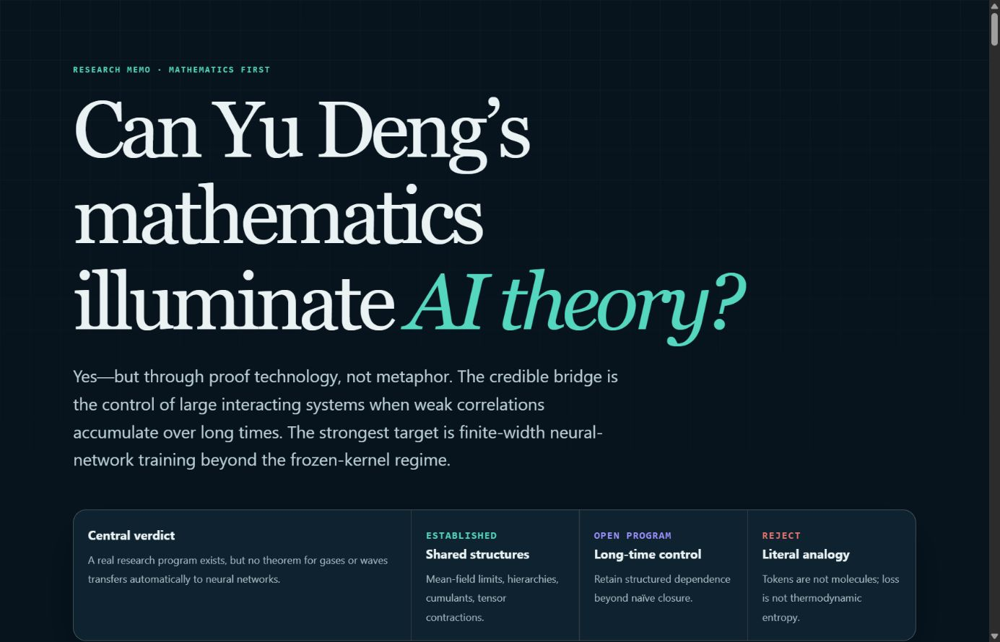

# Yu Deng’s Fields Medal Lecture — Mathematics, Proof Architecture, and AI

This project turns Yu Deng’s ICM 2026 Fields Medal Award Lecture into two complementary, browser-based study artifacts:

1. a self-contained PhD-level mini-course on the mathematics behind the lecture; and
2. a research memo asking—carefully and mathematically—whether Deng’s proof ideas could inform AI theory.

## Original lecture

[Watch: ICM 2026 — Fields Medal Award Lecture — Yu Deng](https://youtu.be/2nMnhpiTbmQ)

A locally held transcript was the narrative starting point; it is intentionally excluded from this public repository. The mathematical exposition was expanded and checked against primary papers where the lecture necessarily compresses definitions, hypotheses, scaling limits, and proof architecture.

## Live GitHub Pages

Click either preview to open the corresponding interactive page.

### From Newton to Boltzmann to Fluids

[](https://az9713.github.io/field-medal-lecture-and-AI/yu_deng_fields_lecture_phd.html)

A graduate mini-course covering hard-sphere mechanics, Boltzmann–Grad scaling, BBGKY, propagation of chaos, Lanford’s theorem, the Deng–Hani–Ma long-time breakthrough, hydrodynamic limits, wave kinetic theory, random tensors, and worked proof expansions.

### Can Yu Deng’s Mathematics Illuminate AI Theory?

[](https://az9713.github.io/field-medal-lecture-and-AI/yu_deng_ai_research_connections.html)

A source-linked research memo separating established mathematical overlap from conjectural transfer. It examines neural mean-field limits, the neural tangent hierarchy, transformers, random tensors, diffusion models, and mean-field Langevin dynamics. Literal analogies such as “tokens are molecules” are explicitly rejected.

## Development journey

The project evolved in several passes:

- The lecture transcript was first reconstructed as a navigable mathematical course.
- Compressed arguments were expanded into definitions, intermediate algebra, assumptions, mental pictures, and explicit proof dependencies.
- Complete pedagogical derivations were separated from research-scale proof architecture so the exposition would not pretend to reproduce a 100–200 page proof in a few paragraphs.
- Qualitative explanations and SVG diagrams were added without removing the technical mathematics.
- The inquiry then pivoted toward AI theory. The resulting memo tests possible connections using equations and falsifiable research targets rather than metaphor.
- A final stochastic pass distinguished ordinary score-based diffusion—whose samples are independent once the score is fixed—from genuinely interacting mean-field Langevin and McKean–Vlasov systems, where propagation of chaos is mathematically relevant.

## Repository guide

| File | Purpose |
|---|---|
| `index.html` | GitHub Pages entry point; redirects to the main lecture |
| `yu_deng_fields_lecture_phd.html` | Main PhD-level lecture and proof guide |
| `yu_deng_ai_research_connections.html` | AI-theory connections and proposed research program |
| `CONTENT_REVIEW.md` | Content audit, improvements, verification sources, and remaining scope |
| `assets/screenshots/` | README previews of the two live pages |

## Reading principle

The pages use three distinct epistemic levels:

- **Complete derivation:** the substantive steps are supplied at graduate-lecture level.
- **Proof architecture:** the logical modules of a research-scale proof are explained, but completeness is not claimed.
- **Proposed research program:** a mathematically motivated conjecture or transfer target, clearly distinguished from an established theorem.

Equations are rendered with MathJax. For local viewing, serve the directory rather than opening the files directly:

```powershell
python -m http.server 8765
```

Then open `http://127.0.0.1:8765/yu_deng_fields_lecture_phd.html`.

## Attribution and scope

This is an independent educational and research artifact based on the linked lecture and cited primary sources. It does not claim endorsement by Yu Deng or by the authors of the AI-theory papers. Proposed connections are labelled as proposals, not attributed to the original researchers.
